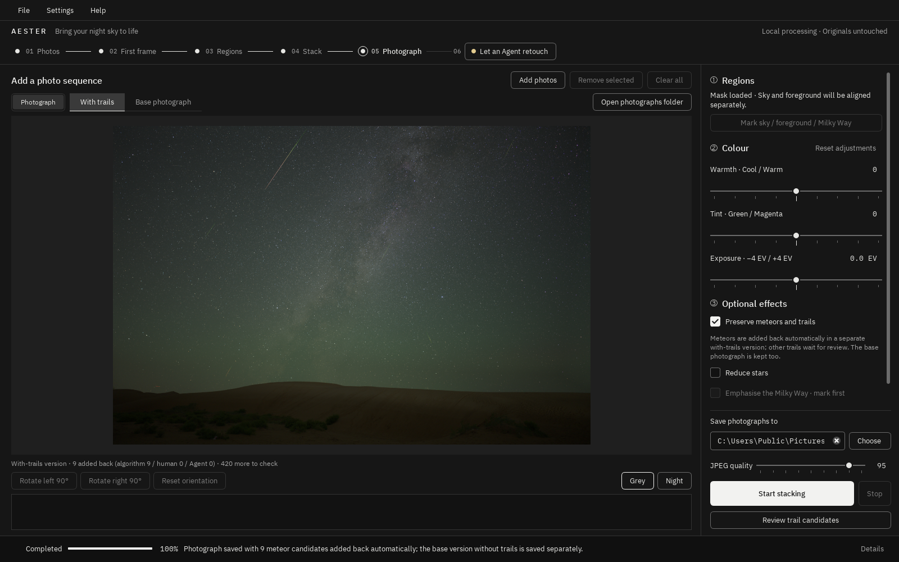

# Aester · Let the night sky come through naturally

Aester is a star-field and Milky Way post-processing application that runs locally on Windows.

- **Automatic**: give it a series of camera RAW files shot from one position, and it stacks them, aligns and blends sky and foreground separately, reduces noise and delivers finished images.
- **Optional**: meteor add-back, Milky Way enhancement and layered export are available when you want them.
- **AI assistants**: an MCP-capable AI assistant can operate Aester, and GIMP can be driven with natural-language retouching.

Aester is free forever and open source, and needs no account. Supporting development is voluntary and unlocks nothing.

[中文](README.md) · [Download](https://github.com/slbz-afk/Aester/releases) · [User guide](docs/USER_GUIDE_EN.md) · [Issues](https://github.com/slbz-afk/Aester/issues) · [Support](SUPPORT.md)



*48 frames of the Tengger Desert stacked. The meteors were judged and added back automatically, and some judgements can be wrong; you can check and change each one under **Review trail candidates**.*

## How it works

The window follows six stages:

1. **Photos**: add one series of RAW files from the same position and framing (at least 3, at most 300). Originals are read-only and never modified.
2. **First frame**: a preview from the first photo with the camera's look applied. Adjust temperature, tint and exposure; the preview and the final image share one colour pipeline.
3. **Regions**: draw the foreground boundary, and an ellipse around the Milky Way if there is one. The sky moves over time while the foreground does not, so the two are aligned separately. Without a foreground boundary the whole frame is treated as sky.
4. **Process**: runs in the background and shows the stage and progress. You can stop it and later continue from its last checkpoint with **Resume job**.
5. **Results**: every job delivers three images:
   - a JPEG to share;
   - a 16-bit TIFF to keep editing;
   - a 32-bit float linear master for deep post-processing.
6. **Let an agent retouch it**: Aester writes a prompt for your AI assistant. The assistant reads the result through Aester's MCP server and retouches it locally in GIMP from your description. The retouched version is saved separately.

**Optional effects (all off by default):**

- **Preserve meteors and trails**: the base image is finished first. Meteors the algorithm considers reliable are then added back automatically and saved as a separate version; other trails are left for you to review. You can check and change each decision under **Review trail candidates** and render again. Review uses the job's cache, so do not clean it before you have finished reviewing.
- **Enhance the Milky Way**: a graded enhancement inside the drawn Milky Way ellipse only.

See the [user guide](docs/USER_GUIDE_EN.md) for details.

## Download and install

Download `Aester-…-Setup.exe` from [Releases](https://github.com/slbz-afk/Aester/releases).

- **System**: Windows 10 / 11, 64-bit. Per-user installation; no administrator rights needed.
- **Internet**:
  - During installation about 290 MB of core components is downloaded, and every file is verified by SHA-256.
  - The Python packages (about 124 MB) come from the official servers or listed mirrors in mainland China, whichever is fastest.
  - Siril (about 166 MB) comes only from the official Siril site, free-astro.org; there is no mirror.
  - Afterwards Aester runs fully offline.
- **Disk**:
  - About 1–2 GB for the program and components.
  - Processing cache is extra: with default settings about 0.9 GB per 45 MP RAW file, for example about 50–80 GB for 48 files and about 150 GB for 150 files. Cache scales roughly with pixel count (estimate): about 0.5 GB per photo at 24 MP and 1.3 GB at 61 MP; the check at start uses your actual files.
  - Caches can be cleaned per job under Settings → Photographs and cache. After cleaning, that job's trails can no longer be reviewed.
- **Memory**: 16 GB or more recommended.
- **Unsigned installer**: Windows may show "Windows protected your PC". If the file comes from this page and the checksum matches, choose "More info → Run anyway".

**Checking the checksum**: on the Releases page, `SHA256SUMS.txt` sits next to the installer; each line holds a file's SHA-256 and its name. After downloading, open PowerShell in the folder that holds the installer and run:

```powershell
Get-FileHash .\Aester-…-Setup.exe -Algorithm SHA256
```

Replace the whole `Aester-…-Setup.exe` with the name of the file you downloaded, for example `.\Aester-1.0.0-rc.1-Setup.exe`. (To open PowerShell in that folder, type powershell in File Explorer's address bar and press Enter.) If the Hash shown equals the line for the same file in `SHA256SUMS.txt` (upper or lower case does not matter), the file is intact.

### Windows Smart App Control

When Smart App Control is on in Windows 11, it blocks programs that Microsoft cannot judge to be safe and that have no valid signature, and it cannot make an exception for a single program. Aester and the official Siril it uses are not code-signed, so they may be blocked.

- **To check whether it is on**: open Windows Security → App & browser control → Smart App Control settings. The state is On, Evaluation or Off; in Evaluation it blocks nothing.
- **If Aester is blocked**: the only remedy is to set it to Off in the same place. Before you do, note that whether you can turn it on again depends on your Windows version; on older versions it can only be turned on again after resetting or reinstalling Windows.
- **Windows 10** does not have this feature.

Based on Microsoft's pages: [Smart App Control FAQ](https://support.microsoft.com/en-us/topic/what-is-smart-app-control-285ea03d-fa88-4d56-882e-6698afdb7003) and [App & browser control in the Windows Security app](https://support.microsoft.com/en-us/windows/app-browser-control-in-the-windows-security-app-8f68fb65-ebb4-3cfb-4bd7-ef0f376f3dc3).

## Cameras

- **Tested with real sequences**: the Nikon Z 8 has gone through the full workflow with real night-sky sequences. A set of 16 ZWO Seestar S30 Pro deep-sky exposures goes through the full stacking job (tier A in `starstack devices`), but the look did not pass our image-quality check, and smart-telescope work is paused.
- **Decoded but not sequence-tested**: twenty-odd Sony, Nikon and Canon bodies; most have a default camera look.
- **Other cameras**: work if LibRaw 0.22.1 can decode them.

Run `starstack devices` for the full list. Reports with your camera are welcome.

## Known limitations

- **Not every scene comes out right straight away.** Clouds, obstructions, trees moving in the wind, strong light pollution and colour fringing remain hard. Deep-sky images from smart telescopes have basic support only.
- **At most 300 photos per job.** Split longer sequences into segments; each segment gives its own image, and segments are not combined automatically. The longest continuous sequence tested so far is about 31 minutes; until longer ones are tested, keep each segment to about 30 minutes and no more than about 150 photos, whichever comes first.
- **Meteor identification is not guaranteed.** A trail added back automatically may still be a satellite or an aircraft, and meteors can be missed; check them under **Review trail candidates**.
- **Reduce stars is not available.** It needs the optional nox model; the rights to that third-party model's training data are still being checked, so it is not offered for download. When it is, it remains an algorithmic estimate; bright stars may keep a residual halo.
- **Retouching needs GIMP 3.2.6** and your own AI assistant with MCP and image support.
- **Little testing on other PCs.** Testing on other computers and on high-DPI multi-monitor setups is still limited. Please [report problems](https://github.com/slbz-afk/Aester/issues).

## AI assistants

Aester includes an MCP server with tools for import, regions, processing, trail review, stars (needs a star-removal model; not available for now), Milky Way, export and retouching. The welcome screen copies a client configuration and tests the connection. See the [user guide](docs/USER_GUIDE_EN.md#mcp).

## Licence

Aester is free software, Copyright (C) 2026 Wang Jian (王俭).

| Part | Licence |
| --- | --- |
| Processing engine, command line and MCP server (`src/starstack` and more) | [Apache-2.0](LICENSE) |
| Desktop application (`src/aester_desktop`) | [GPL-3.0-or-later](src/aester_desktop/LICENSE.txt) |
| Third-party components (Siril, GIMP, Qt, LibRaw, fonts and others) | their own licences, see [THIRD_PARTY.md](THIRD_PARTY.md) |

The name Aester and its icon are not licensed; modified versions must use a different name and icon ([TRADEMARKS.md](TRADEMARKS.md)). The per-folder details are in [LICENSING.md](LICENSING.md).

## Contributing

Issues, sample reports and code are welcome; please read [CONTRIBUTING.md](CONTRIBUTING.md). Report security problems privately as described in [SECURITY.md](SECURITY.md).
