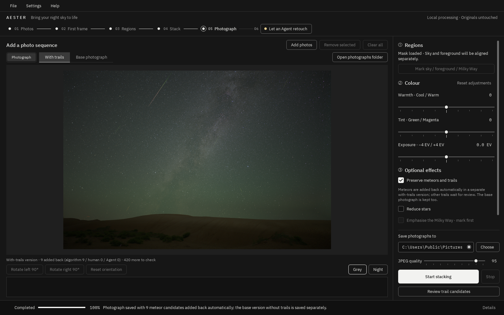

# Aester · Let the night sky come through naturally

Aester is a star-field and Milky Way post-processing application that runs locally on Windows.

- **Automatic**: give it a series of camera RAW files shot from one position, and it stacks them, aligns and blends sky and foreground separately, reduces noise and delivers finished images.
- **Optional**: meteor add-back, star cleanup, Milky Way enhancement and layered export are available when you want them.
- **AI assistants**: an MCP-capable AI assistant can operate Aester, and GIMP can be driven with natural-language retouching.

Aester is free and open source. Supporting development is voluntary and unlocks nothing.

[中文](README.md) · [Download](https://github.com/slbz-afk/Aester/releases) · [User guide](docs/USER_GUIDE_EN.md) · [Issues](https://github.com/slbz-afk/Aester/issues) · [Support](SUPPORT.md)

## How it works

The window follows six stages:

1. **Photos**: add one series of RAW files from the same position and framing (at least 3). Originals are read-only and never modified.
2. **First frame**: a preview from the first photo with the camera's look applied. Adjust temperature, tint and exposure; the preview and the final image share one colour pipeline.
3. **Regions**: draw the foreground boundary, and an ellipse around the Milky Way if there is one. The sky moves over time while the foreground does not, so the two are aligned separately. Without a foreground boundary the whole frame is treated as sky.
4. **Process**: runs in the background with stage, progress and time remaining. It can be stopped and resumed.
5. **Results**: every job delivers three images:
   - a JPEG to share;
   - a 16-bit TIFF to keep editing;
   - a 32-bit float linear master for deep post-processing.
6. **Let an agent retouch it**: Aester writes a prompt for your AI assistant. The assistant reads the result through Aester's MCP server and retouches it locally in GIMP from your description. The retouched version is saved separately.

**Optional effects (all off by default):**

- **Keep meteors and other trails**: the base image is finished first. Reliably measured meteors are then added back and saved as a separate version, with a review screen to change each decision.
- **Star cleanup**: needs the optional nox component. It separates stars from the background and reduces them by 0–100%. You can also save starless and star layers.
  **1.0.0-rc.1 does not offer the nox download yet**: the rights to the third-party model's training data are still being checked, so this feature is unavailable until then.
- **Enhance the Milky Way**: a graded enhancement inside the drawn Milky Way ellipse only.

See the [user guide](docs/USER_GUIDE_EN.md) for details.

## Download and install

Download `Aester-…-Setup.exe` from [Releases](https://github.com/slbz-afk/Aester/releases) and check the SHA-256 shown there.

- **System**: Windows 10 / 11, 64-bit. Per-user installation; no administrator rights needed.
- **Internet**:
  - The installer downloads about 290 MB of core components from the official servers or listed mirrors, whichever is fastest, and verifies every file by SHA-256.
  - Afterwards Aester runs fully offline.
- **Disk**:
  - About 1–2 GB for the program and components.
  - Processing cache is extra: about 50–80 GB for one job of 48 RAW files at 45 MP.
  - Caches can be cleaned per job under Settings → Results and cache.
- **Memory**: 16 GB or more recommended.
- **Unsigned installer**: Windows may show "Windows protected your PC". If the file comes from this page and the checksum matches, choose "More info → Run anyway".

## Cameras

- **Full workflow tested**: Nikon Z 8 and ZWO Seestar S30 Pro, with real sequences.
- **Decoded but not sequence-tested**: twenty-odd Sony, Nikon and Canon bodies; most have a default camera look.
- **Other cameras**: work if LibRaw 0.22.1 can decode them.

Run `starstack devices` for the full list. Reports with your camera are welcome.

## Known limitations

- **Not every scene comes out right straight away.** Clouds, obstructions, trees moving in the wind, strong light pollution and colour fringing remain hard. Deep-sky images from smart telescopes have basic support only.
- **Star cleanup is not available yet** (see above). When it is, it remains an algorithmic estimate; bright stars may keep a residual halo.
- **Meteor add-back covers reliably measured meteors only**; other trails are left for manual review.
- **Retouching needs GIMP 3.2.6** and your own AI assistant with MCP and image support.
- **Little testing on other PCs.** Testing on other computers and on high-DPI multi-monitor setups is still limited. Please [report problems](https://github.com/slbz-afk/Aester/issues).

## AI assistants

Aester includes an MCP server with tools for import, regions, processing, trail review, stars, Milky Way, export and retouching. The welcome screen copies a client configuration and tests the connection. See the [user guide](docs/USER_GUIDE_EN.md#mcp).

## Licence

Aester is free software, Copyright (C) 2026 Wang Jian (王俭).

| Part | Licence |
| --- | --- |
| Processing engine, command line and MCP server (`src/starstack` and more) | [Apache-2.0](LICENSE) |
| Desktop application (`src/aester_desktop`) | [GPL-3.0-or-later](src/aester_desktop/LICENSE.txt) |
| Third-party components (Siril, GIMP, Qt, LibRaw, fonts and others) | their own licences, see [THIRD_PARTY.md](THIRD_PARTY.md) |

The name Aester and its icon are not licensed; modified versions must use a different name and icon ([TRADEMARKS.md](TRADEMARKS.md)). The per-folder details are in [LICENSING.md](LICENSING.md).

## Contributing

Issues, sample reports and code are welcome; please read [CONTRIBUTING.md](CONTRIBUTING.md). Report security problems privately as described in [SECURITY.md](SECURITY.md).
