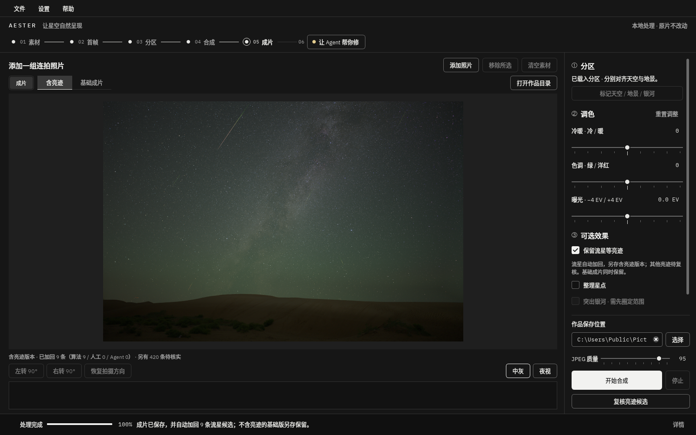

# Aester · 让星空自然呈现

Aester 是在 Windows 运行的星空摄影后期软件。

- **自动完成**：把同一机位连拍的一组相机 RAW 交给Aester，它会完成堆栈、天空与地景分开对齐合成、降噪和出片。
- **可选效果**：流星等亮迹的自动识别与加回、星点整理、银河增强和素材分层导出。
- **AI 助手**：让支持 MCP 的 AI agent操作 Aester，甚至调用 GIMP 让你能用自然语言修图。

Aester 完整免费、开源。

[English](README.en.md) · [下载](https://github.com/slbz-afk/Aester/releases) · [使用指南](docs/USER_GUIDE.md) · [问题反馈](https://github.com/slbz-afk/Aester/issues) · [支持开发](SUPPORT.md)

## 使用入门

一次出片流程分为六个阶段：

1. **素材导入**：添加一组星空连拍 RAW，至少 3 张。原片只读，不会被改动。
2. **首帧预览**：默认用第一张照片生成预览，并按机型匹配色彩。这一步可调白平衡调和曝光，确定成片的曝光和颜色处理。
3. **分区处理**：先画出地景边界，有银河时，拖出银河椭圆。天空随时间移动、地景固定不动，所以两者被分开对齐。不画地景时按全天空处理。
4. **配准合成**：在后台处理，自动配准畸变并堆栈，显示处理阶段、进度和剩余时间（估计）。中途可以暂停，之后从断点继续。
5. **导出成片**：一次流程得到三份图像：
   - 直接分享的 JPEG；
   - 可继续编辑的 16 位 TIFF；
   - 供深度后期的 32 位浮点线性母版。
6. **Agent修图**：软件提供给 AI agent的提示词和MCP工具，让你的agent通过 Aester 的 MCP 获取合成成片，再用 GIMP 按你的自然语言要求修图，修好的版本另存。

**可选效果**

- **保留流星等亮迹**：先完成基础成片，再加回被自动识别到、再经你人工复核的流星等亮迹事件，再另存为含亮迹版本——高效出流星雨图。
- **整理星点（去星、缩星）**：需要可选的 nox 组件。把星点从背景分离，按 0–100% 减弱星点，并可另存无星图和星点层。
  1.0.0-rc.1 暂不提供 nox 下载，这个第三方模型的训练数据权利还在核查，这项功能暂时用不了。
- **增强银河**：只在画定的银河椭圆内做渐变增强，提升银河可见度。

完整说明见[使用指南](docs/USER_GUIDE.md)。

## 下载与安装

到 [Releases](https://github.com/slbz-afk/Aester/releases) 下载 `Aester-…-Setup.exe`。

- **系统**：Windows 10 / 11，64 位。
- **需要联网**：
  - 基础组件约 290 MB，安装器会从官方服务器或国内镜像中选最快的一处下载，每个文件都校验 SHA-256；
  - 装好后可以完全离线使用。
- **磁盘空间**：
  - 程序和组件约 1–2 GB；
  - 处理时另需缓存，视素材规模而定，大规模素材例如48 张 4500 万像素 RAW，需要约 50–80 GB缓存；
  - 缓存可以在“设置 → 作品与缓存”里按任务清理。
- **内存**：建议 16 GB 或以上。
- **未签名提示**：安装包没有代码签名，Windows 可能提示“已保护你的电脑”。确认文件来自本页面、校验值一致后，点“更多信息 → 仍要运行”。

## 支持的相机

- **完整验收**：Nikon Z 8 和 ZWO Seestar S30 Pro 用真实素材走通了完整流程。
- **能解码**：Sony、Nikon、Canon 的二十多款机身能解码，色彩接近相机默认观感，但没有用真实星空素材验收。
- **其他机型**：取决于 LibRaw 0.22.1 能否解码。

完整列表可以运行 `starstack devices` 查看。欢迎用你的相机试用并反馈。

## 已知限制

- **不保证所有场景都能直出**：云、遮挡、风动的树枝、强光害和彩边仍会导致瑕疵；智能望远镜的深空素材只能做有限处理。
- **整理星点（去星、缩星）功能暂不可用**：见上文。
- **流星识别不保证完全正确**：算法不能区分亮迹的身份时，需要人工复核，小概率遗漏流星或错加飞机。
- **AI修图需要另装软件**：要自己装 GIMP 3.2.6，以及你自己的、支持 MCP 和识图的 AI agent。
- **测试有限**：其他电脑和高 DPI 多显示器上的实测还很少，遇到问题请[反馈](https://github.com/slbz-afk/Aester/issues)。

## 让 AI 助手使用 Aester

Aester 自带 MCP 服务，提供导入、分区、合成、亮迹复核、星点、银河、导出和修图等工具。首次启动的欢迎页可以复制客户端配置，并验证连接。详见[使用指南](docs/USER_GUIDE.md#mcp)。

## 许可

Aester 是自由软件，Copyright (C) 2026 Wang Jian（王俭）。

| 部分 | 许可证 |
| --- | --- |
| 处理引擎、命令行与 MCP 服务（`src/starstack` 等） | [Apache-2.0](LICENSE) |
| 桌面程序（`src/aester_desktop`） | [GPL-3.0-or-later](src/aester_desktop/LICENSE.txt) |
| 第三方组件（Siril、GIMP、Qt、LibRaw、字体等） | 各自的许可证，见 [THIRD_PARTY.md](THIRD_PARTY.md) |

Aester 名称与图标不在许可范围内，修改后再发布的版本请改用其他名称和图标，见 [TRADEMARKS.md](TRADEMARKS.md)。分区说明见 [LICENSING.md](LICENSING.md)。

## 参与开发

欢迎提交问题、样张反馈和代码。提交前请读 [CONTRIBUTING.md](CONTRIBUTING.md)。安全问题请按 [SECURITY.md](SECURITY.md) 私下报告。
