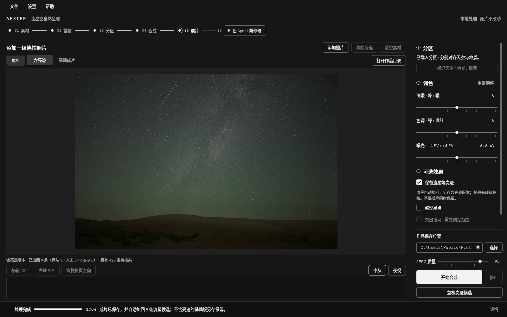

# Aester · 让星空自然呈现

Aester 是在 Windows 运行的星空摄影后期软件。

- **自动完成**：把同一机位连拍的一组相机 RAW 交给Aester，它会完成堆栈、天空与地景分开对齐合成、降噪和出片。
- **可选效果**：流星等亮迹的自动识别与加回、银河增强和素材分层导出。
- **AI 助手**：让支持 MCP 的 AI agent操作 Aester，甚至调用 GIMP 让你能用自然语言修图。

Aester 永久免费、开源，无需账号。

[English](README.en.md) · [下载](https://github.com/slbz-afk/Aester/releases) · [使用指南](docs/USER_GUIDE.md) · [问题反馈](https://github.com/slbz-afk/Aester/issues) · [支持开发](SUPPORT.md)



*腾格里沙漠 48 张合成（从 144 张连拍里每 3 张取 1 张）。算法自动加回了 9 条亮迹，作者逐条复核：6 条是流星，另 3 条多半是飞机或卫星反光。识别会出错，可在“复核亮迹候选”里逐条查看和修改。*

## 使用入门

一次出片流程分为六个阶段：

1. **素材导入**：添加一组星空连拍 RAW，至少 3 张，最多 300 张。原片只读，不会被改动。
2. **首帧预览**：默认用第一张照片生成预览，并按机型匹配色彩。这一步可调白平衡调和曝光，确定成片的曝光和颜色处理。
3. **分区处理**：先画出地景边界，有银河时，拖出银河椭圆。天空随时间移动、地景固定不动，所以两者被分开对齐。不画地景时按全天空处理。
4. **配准合成**：在后台处理，自动配准畸变并堆栈，显示处理阶段和进度。可以中途停止，之后点“继续任务”从检查点接着处理。
5. **导出成片**：一次流程得到三份图像：
   - 直接分享的 JPEG；
   - 可继续编辑的 16 位 TIFF；
   - 供深度后期的 32 位浮点线性母版。
6. **Agent修图**：软件提供给 AI agent的提示词和MCP工具，让你的agent通过 Aester 的 MCP 获取合成成片，再用 GIMP 按你的自然语言要求修图，修好的版本另存。

**可选效果**

- **保留流星等亮迹**：先完成基础成片，再把算法认为可信的流星自动加回，另存为含亮迹版本；其他亮迹留给你复核。之后可以在“复核亮迹候选”里逐条查看、修改，再出一版。复核要用这个任务的缓存，复核完之前不要清理。
- **增强银河**：只在画定的银河椭圆内做渐变增强，提升银河可见度。

拍流星雨的步骤和截图见[流星雨合成图解](docs/METEOR_SHOWER.md)（适用于 v1.0.0-rc.2 及之后的版本）。

完整说明见[使用指南](docs/USER_GUIDE.md)。

## 下载与安装

到 [Releases](https://github.com/slbz-afk/Aester/releases) 下载 `Aester-…-Setup.exe`。

- **系统**：Windows 10 / 11，64 位。
- **需要联网**：
  - 安装时下载基础组件约 290 MB，每个文件都校验 SHA-256；
  - 其中 Python 软件包约 124 MB，安装器会从官方服务器或国内镜像中选最快的一处下载；
  - Siril 约 166 MB，只从 Siril 官网 free-astro.org 下载，没有国内镜像；
  - 装好后可以完全离线使用。
- **磁盘空间**：
  - 程序和组件约 1–2 GB；
  - 处理时另需缓存：默认设置下每张 4500 万像素 RAW 约 0.9 GB，例如 48 张约需 50–80 GB，150 张约需 150 GB。缓存大致与像素数成正比（估算）：2400 万像素约 0.5 GB/张，6100 万像素约 1.3 GB/张；开始合成时会按你照片的实际像素检查磁盘空间；
  - 缓存可以在“设置 → 作品与缓存”里按任务清理。清理后就不能再复核这个任务的亮迹。
- **内存**：建议 16 GB 或以上。
- **未签名提示**：安装包没有代码签名，Windows 可能提示“已保护你的电脑”。确认文件来自本页面、校验值一致后，点“更多信息 → 仍要运行”。

**核对校验值**：Releases 页面上，安装包旁边有 `SHA256SUMS.txt`，每行是一个文件的 SHA-256 和文件名。下载安装包后，在它所在的文件夹打开 PowerShell，运行：

```powershell
Get-FileHash .\Aester-…-Setup.exe -Algorithm SHA256
```

把 `Aester-…-Setup.exe` 整个换成你下载的文件名，例如 `.\Aester-1.0.0-rc.1-Setup.exe`。（在文件资源管理器中打开安装包所在文件夹，在地址栏输入 powershell 后回车，即可在该文件夹打开 PowerShell。）输出的 Hash 与 `SHA256SUMS.txt` 里同名文件那一行相同（大小写不同不要紧），说明文件完整。

### Windows 智能应用控制

Windows 11 的“智能应用控制”开着时，会拦下微软无法判断是否安全、又没有有效签名的程序，而且不能单独放行某个程序。Aester 和它使用的官方 Siril 都没有代码签名，可能被拦下。

- **查看是否开启**：打开“Windows 安全中心 → 应用和浏览器控制 → 智能应用控制设置”。状态有“开”“评估”“关”三种，“评估”时不拦截。
- **被拦下时**：唯一的办法是在同一处把它改为“关”。改之前请知道：以后能不能重新打开，取决于你的 Windows 版本，旧版本要重置或重装系统才能再打开。
- **Windows 10** 没有这项功能。

以上依据微软的说明：[智能应用控制常见问题解答](https://support.microsoft.com/zh-cn/topic/what-is-smart-app-control-285ea03d-fa88-4d56-882e-6698afdb7003)、[Windows 安全中心的应用和浏览器控制](https://support.microsoft.com/zh-cn/windows/windows-%E5%AE%89%E5%85%A8%E4%B8%AD%E5%BF%83%E5%BA%94%E7%94%A8%E4%B8%AD%E7%9A%84%E5%BA%94%E7%94%A8%E5%92%8C%E6%B5%8F%E8%A7%88%E5%99%A8%E6%8E%A7%E5%88%B6-8f68fb65-ebb4-3cfb-4bd7-ef0f376f3dc3)。

## 支持的相机

- **实拍验证**：Nikon Z 8 用真实星野连拍走通了完整流程。ZWO Seestar S30 Pro 的一组 16 张深空逐张曝光能完整走通堆栈作业（`starstack devices` 中为 A 级），但画面观感没有通过验收，智能望远镜的适配目前暂停。
- **能解码**：Sony、Nikon、Canon 的二十多款机身能解码，色彩接近相机默认观感，但没有用真实星空素材验收。
- **其他机型**：取决于 LibRaw 0.22.1 能否解码。

完整列表可以运行 `starstack devices` 查看。欢迎用你的相机试用并反馈。

## 已知限制

- **不保证所有场景都能直出**：云、遮挡、风动的树枝、强光害和彩边仍会导致瑕疵；智能望远镜的深空素材只能做有限处理。
- **每个任务最多 300 张**：更长的连拍要分成几段，各段分别出图，段与段之间不能自动合成。目前实测过的连续序列最长约 31 分钟；在验证更长的序列之前，建议每段不超过约 30 分钟，也不超过约 150 张，以先到者为准。
- **流星识别不保证正确**：自动加回的也可能是卫星或飞机，也可能漏掉流星。请在“复核亮迹候选”里检查；亮流星还可能整条漏掉，复核列表里也没有，拍摄时看到过的，请在含亮迹成片里找一找，见[使用指南](docs/USER_GUIDE.md#meteor-shower)“流星雨合成”一节的“尚未验证与已知问题”。
- **整理星点（去星、缩星）暂时用不了**：它需要可选的 nox 模型，这个第三方模型的训练数据权利还在核查，目前不提供下载。
- **AI修图需要另装软件**：要自己装 GIMP 3.2.6，以及你自己的、支持 MCP 和识图的 AI agent。
- **测试有限**：其他电脑和高 DPI 多显示器上的实测还很少，遇到问题请[反馈](https://github.com/slbz-afk/Aester/issues)。

## 让 AI 助手使用 Aester

Aester 自带 MCP 服务，提供导入、分区、合成、亮迹复核、星点（需要去星模型，目前不可用）、银河、导出和修图等工具。首次启动的欢迎页可以复制客户端配置，并验证连接。详见[使用指南](docs/USER_GUIDE.md#mcp)。

## 许可

Aester 是自由软件，Copyright (C) 2026 Wang Jian（王俭）。

| 部分 | 许可证 |
| --- | --- |
| 处理引擎、命令行与 MCP 服务（`src/starstack` 等） | [Apache-2.0](LICENSE) |
| 桌面程序（`src/aester_desktop`） | [GPL-3.0-or-later](src/aester_desktop/LICENSE.txt) |
| 第三方组件（Siril、GIMP、Qt、LibRaw、字体等） | 各自的许可证，见 [THIRD_PARTY.md](THIRD_PARTY.md) |

Aester 名称与图标不在许可范围内，修改后再发布的版本请改用其他名称和图标，见 [TRADEMARKS.md](TRADEMARKS.md)。分区说明见 [LICENSING.md](LICENSING.md)。

## 参与开发

欢迎提交问题、样张反馈和代码。提交前请读 [CONTRIBUTING.md](CONTRIBUTING.md)。安全问题请按 [SECURITY.md](SECURITY.md) 私下报告。
