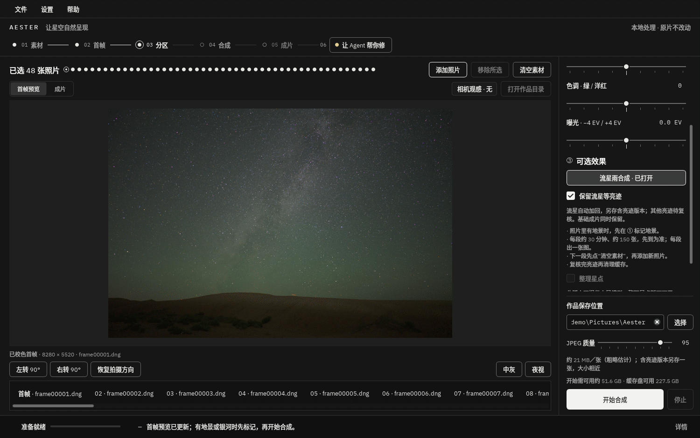
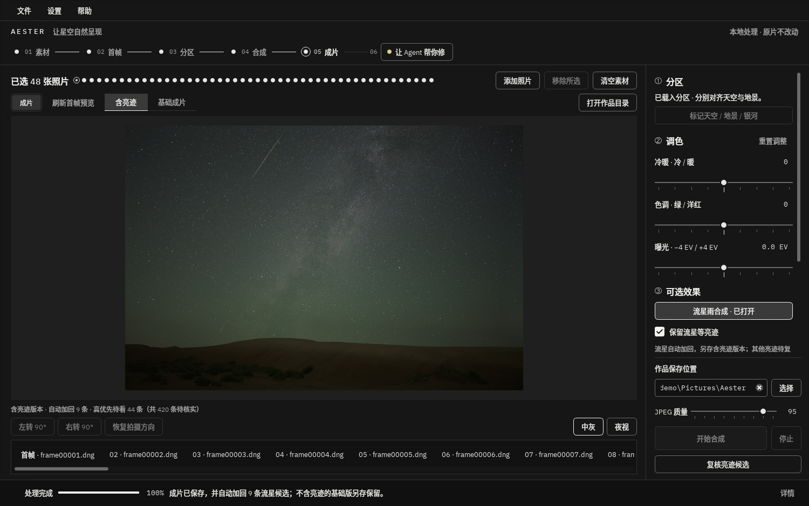
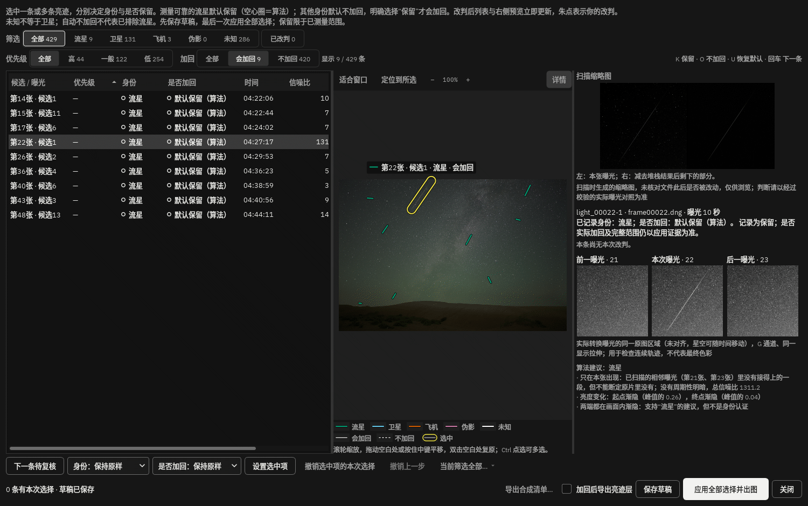
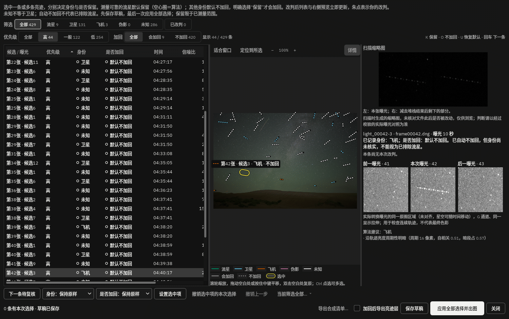
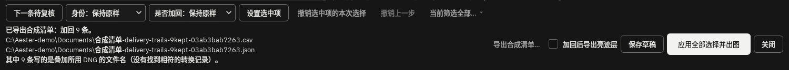
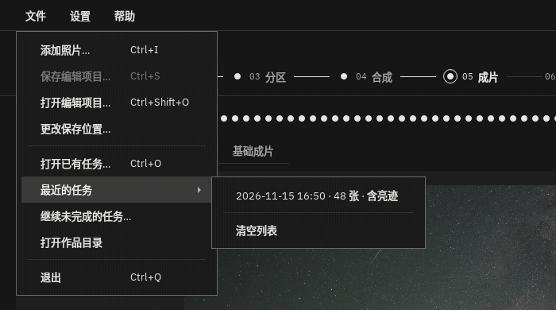

# 流星雨合成 · 图解

这一页用截图走一遍一段流星雨照片的处理，顺序与[使用指南的“流星雨合成”一节](USER_GUIDE.md#meteor-shower)相同，各个按钮的细节以指南为准。截图来自 v1.0.0-rc.1 之后的版本；rc.1 还没有“流星雨合成”按钮、开始前的空间预估、复核里的优先级筛选和合成清单。还没装 Aester 的，先看[使用指南](USER_GUIDE.md)开头的安装说明。

示例是同一机位连拍的 48 张照片，每 3 张取 1 张，只用来演示界面。实际拍摄时请连续拍、张张都导入，原因见第 2 步和指南。截图里的字较小，点图可看原尺寸。

## 1. 打开流星雨合成，添加这一段的照片

在右栏 ③ 可选效果里点“流星雨合成”。它会勾上“保留流星等亮迹”，按钮变成“流星雨合成 · 已打开”，下方出现几行提示。添加这一段的照片后，“开始合成”上方会显示开始所需的缓存空间和缓存盘的可用空间。

截图里还没有标记地景，所以第一行提示还在。照片里有地景时，先点 ① 分区的“标记天空 / 地景 / 银河”画出地景，再开始合成。

尼康“高效率 RAW”要先装 Adobe DNG Converter（“设置 → 处理后端”里有官方链接），添加照片时软件会转成 DNG 副本，需要一些时间。“开始合成”上方那一行变红，说明缓存盘放不下这一段，办法见指南。

## 2. 开始合成，得到两份成片

点“开始合成”。完成后，结果页签为“含亮迹 / 基础成片”，先显示含亮迹版本；画面下方的说明行写着自动加回了几条，还有几条高优先待看。基础成片始终保留。

点画面右上方的“打开作品目录”取得成片。它打开含亮迹文件夹：里面的 `final.jpg` 和 16 位 `final_srgb16.tif` 是加了流星的图（线性母版不含流星）；旁边的 `delivery-<编号>` 是不加流星的基础成片，留作对照或自己后期。

自动加回是算法的建议，不是身份认证。截图里自动加回了 9 条。这个示例是每 3 张取 1 张；用上全部照片时，这 9 条里有 3 条被算法改判为卫星，这就是要张张导入的原因（见指南“拍摄与分段”）。作者逐条看过：9 条里 6 条是流星，被改判的这 3 条确实不是。处理要多久，目前只有模拟数字，见指南。

## 3. 复核：先看会加回的

点右栏底部的“复核亮迹候选”。先在“加回”筛选里点“会加回”，逐条确认加回的确实是流星。右侧“详情”侧栏里有前一曝光 / 本次曝光 / 后一曝光的实际图像对照；侧栏没有显示时，点预览上方右侧的“详情”。是流星的不用改；在前后曝光里接着出现的，多半是卫星或飞机，选中后按 O（不加回）。

截图里选中的这条只在本次曝光里有，前后两张的同一位置都没有。示例是每 3 张取 1 张，所以这里的“前一曝光”“后一曝光”和本张之间其实还隔着两张没有导入的照片。

## 4. 再看“高”优先级

先在“加回”筛选里点回“全部”，再在“优先级”里点“高”。几个筛选同时生效，自动加回的候选没有优先级，两个一起选会一条也不显示。选中一条后，按 K 保留、O 不加回、U 恢复默认；按回车或点“下一条待复核”，跳到下一条还没有选择的候选。看过的按 K 或 O 记下，“下一条待复核”就不会再跳回它。

截图里这条亮迹是一串亮点，算法的理由是亮度沿轨迹周期性明暗，建议为飞机。没看完可以“保存草稿”；看完点“应用全部选择并出图”，复核窗口随即关闭，软件另存一版含亮迹成片，之前的成片保留。

## 5. 导出合成清单

出图完成后，再点一次“复核亮迹候选”，在复核窗口点“导出合成清单…”，选好位置，软件写出同名的 CSV 和 JSON 两个文件，状态行显示它们的位置。清单写明每条加回的流星来自哪张原片、拍摄时刻和在画面上的位置，方便回到原片核对或自己合成。清单不能存进作品文件夹。它按已经出图的含亮迹版本写，窗口里还没应用的选择不在其中。

示例照片是在 Aester 之外转好的 DNG，缓存里没有它们的转换记录，所以状态行最后一句说明，清单写的是 DNG 的文件名。

## 6. 回到旧任务

重启软件后，从“文件 → 最近的任务”打开这一段；只要中间文件还在，就能接着复核和导出清单。也可以在“设置 → 作品与缓存”选中任务，点“打开此任务”。

## 下一段

复核完、导出清单后，到“设置 → 作品与缓存”选中这一段，点“清理所选任务的中间文件…”；清理后不能再复核，也不能再导出清单。然后点“清空素材”，添加下一段的照片。三脚架没动、上一段的地景是在 Aester 里画的话，等首帧预览出来，点“沿用上一段的地景分区”，核对后点“使用这些分区”，不用重画地景。

超过约 31 分钟的连续序列、真实笔记本上的处理时间目前都没有验证；几段合成一张不受支持，每段出一张图；识别也不保证正确。详见指南[“流星雨合成”](USER_GUIDE.md#meteor-shower)一节的“尚未验证”。
