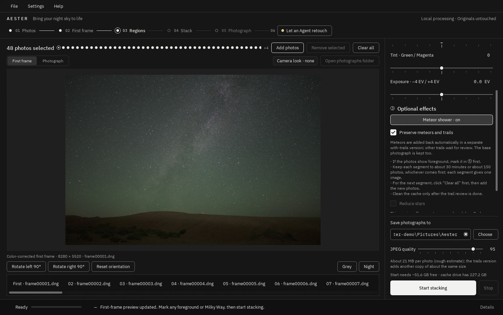
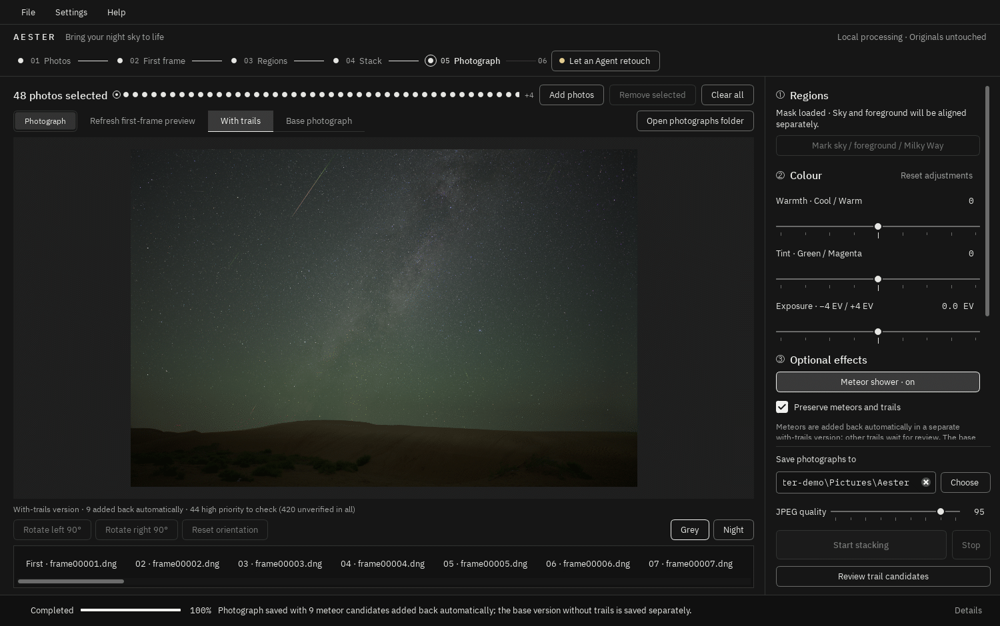
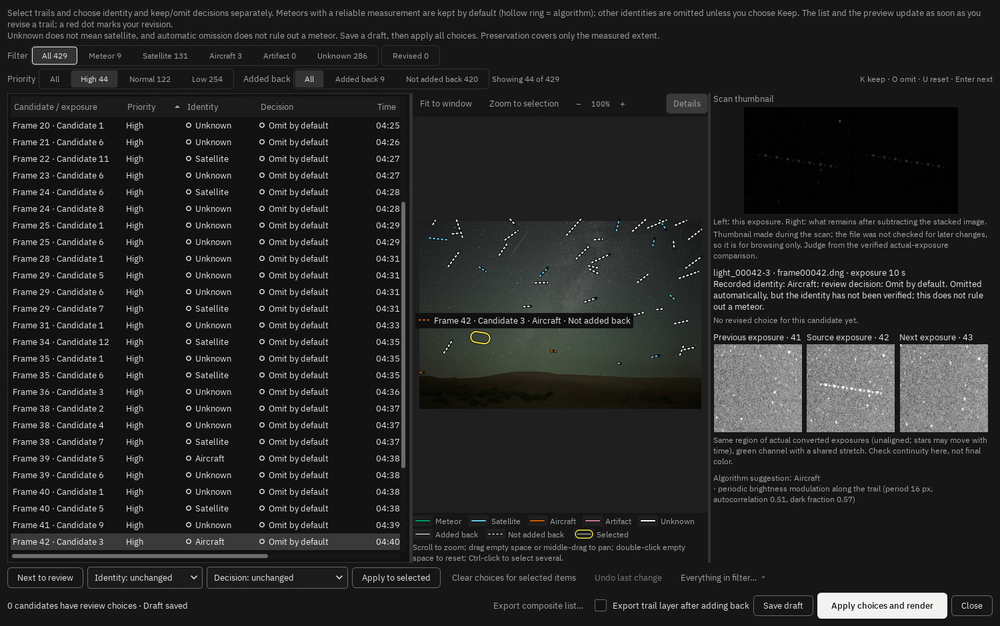
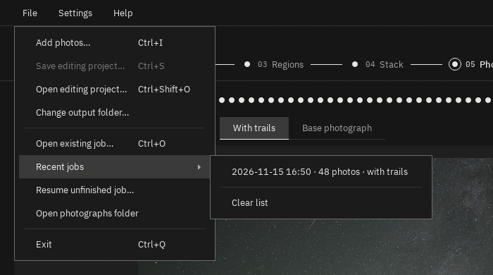

# Meteor showers, illustrated

This page walks through one segment of meteor-shower photos with screenshots, in the same order as “[Meteor showers](USER_GUIDE_EN.md#meteor-shower)” in the user guide; the guide has the details of each control. The screenshots show a version after v1.0.0-rc.1. rc.1 does not have the **Meteor shower** button, the space estimate before start, review priorities or the composite list. If Aester is not installed yet, start with the installation section at the top of the [user guide](USER_GUIDE_EN.md).

The example is 48 photos from one tripod position, every third frame of a continuous sequence, used only to show the interface. When you shoot, shoot continuously and add every frame; step 2 and the guide explain why. The text in the screenshots is small; click an image for full size.

## 1. Turn on meteor-shower mode and add the segment's photos

Click **Meteor shower** in ③ Optional effects. It ticks **Preserve meteors and trails**, the button reads **Meteor shower · on**, and a few hints appear below. Once the segment's photos are added, the line above **Start stacking** shows how much cache space the job needs to start and how much the cache drive has free.

No foreground has been marked yet in this screenshot, so the first hint is still there. If your photos show foreground, mark it first with **Mark sky / foreground / Milky Way** in ① Regions, then start stacking.

Nikon High Efficiency RAW needs Adobe DNG Converter first (the official link is under **Settings → Processing backends**); adding the photos then makes DNG copies, which takes a while. If the line above **Start stacking** turns red, the cache drive cannot hold the segment; the guide says what to do.

## 2. Start stacking and get two photographs

Click **Start stacking**. When the job is done, the result tabs read **With trails / Base photograph**, with the with-trails version shown first. The note under the image says how many trails were added back automatically and how many high-priority candidates are left to check. The base photograph is always kept.

Click **Open photographs folder**, at the top right of the image, to get the photographs. It opens the with-trails folder: `final.jpg` and the 16-bit `final_srgb16.tif` in it are the photograph with meteors (the linear master has none); the `delivery-<token>` folder next to it holds the base photograph without meteors, for comparison or your own editing.

Trails added back automatically are the algorithm's suggestion, not proof of what they are. In the screenshot, 9 were added back. This example uses every third frame; with all frames, the algorithm reclassified 3 of these 9 as satellites, which is why you should add every frame (see “Shooting and segments” in the guide). The photographer checked each one: 6 of the 9 are meteors, and the 3 reclassified ones are indeed not. For processing time there are only simulated figures so far; see the guide.

## 3. Review: start with what was added back

Click **Review trail candidates** at the bottom of the right column. In the **Added back** filter, next to **Priority**, click **Added back** and check one by one that each trail added back is a meteor. The **Details** side panel on the right shows the real previous, source and next exposures side by side; if the panel is hidden, click **Details** above the preview, on the right. Leave real meteors as they are. A trail that continues into the neighbouring exposures is most likely a satellite or aircraft: select it and press O to omit it.

The selected trail appears only in its own exposure; the same spot in the exposures before and after is empty. Because the example uses every third frame, two photos that were not added sit between this exposure and each of its neighbours here.

## 4. Then work through High priority

First set **Added back** back to **All**, then choose **High** under **Priority**. The filters apply together, and trails added back automatically have no priority, so choosing both shows nothing. With a candidate selected, press K to keep it, O to omit it or U to reset it; press Enter or click **Next to review** to move to the next candidate without a choice. Press K or O on each one you have looked at, so **Next to review** does not come back to it.

The selected trail here is a row of bright dots. The algorithm's reason is a periodic brightness change along the trail, and it suggests an aircraft. If you stop part way, click **Save draft**. When you are done, **Apply choices and render** closes the review window, saves a new with-trails photograph and keeps the earlier one.

## 5. Export the composite list

When the render has finished, click **Review trail candidates** again, click **Export composite list…** in the review window and choose where to save it. Aester writes a CSV file and a JSON file with the same name, and the status line shows where they are. The list says which original photo each added-back meteor came from, when it was taken and where it lies in the frame, so you can check it in the original or composite it yourself. The list cannot be saved in the photographs folder. It describes the with-trails version that has been rendered, so choices not yet applied are not in it.

The example photos are DNG files converted outside Aester, so the cache holds no conversion record for them. That is why the last line of the status says the list names the DNG files.

## 6. Come back to a job

After a restart, open the segment from **File → Recent jobs**. As long as its intermediate files are still there, you can continue the review and export the list. You can also select the job under **Settings → Photographs and cache** and click **Open this job**.

## The next segment

After reviewing and exporting the list, select this segment under **Settings → Photographs and cache** and click **Clean intermediate files of selected jobs…**. Once they are cleaned, the segment can no longer be reviewed and no list can be exported for it. Then click **Clear all** and add the next segment's photos. If the tripod has not moved and the previous segment's foreground was drawn in Aester, wait for the first-frame preview, click **Reuse the previous segment’s foreground**, check it and click **Use these regions** instead of drawing it again.

Continuous sequences longer than about 31 minutes and processing time on a real laptop have not been tested; combining segments into one photograph is not supported, so each segment gives its own photograph. Detection is not guaranteed; a bright meteor can be missed entirely and is then not in the review either, so if you saw one while shooting, check that it is in the with-trails photograph. See “Not tested yet and known issues” under “[Meteor showers](USER_GUIDE_EN.md#meteor-shower)” in the guide.
