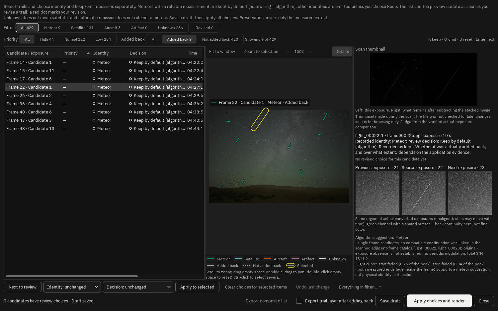
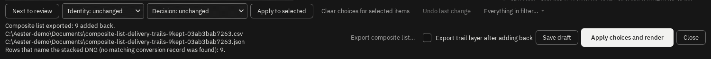

# Meteor showers, illustrated

This page walks through one segment of meteor-shower photos with screenshots, in the same order as “[Meteor showers](USER_GUIDE_EN.md#meteor-shower)” in the user guide; the guide has the details of each control. The screenshots show a version after v1.0.0-rc.1. rc.1 does not have the **Meteor shower** button, the space estimate before start, review priorities or the composite list.

The example is 48 photos from one tripod position, every third frame of a continuous sequence, used only to show the interface. When you shoot, shoot continuously and add every frame; the guide explains why.

## 1. Turn on meteor-shower mode and add the segment's photos

Click **Meteor shower** in ③ Optional effects. It ticks **Preserve meteors and trails**, the button reads **Meteor shower · on**, and a few hints appear below. Once the segment's photos are added, the line above **Start stacking** shows how much cache space the job needs to start and how much the cache drive has free.

No foreground has been marked yet in this screenshot, so the first hint is still there. If your photos show foreground, mark it first with **Mark sky / foreground / Milky Way** in ① Regions, then start stacking.

## 2. Start stacking and get two photographs

Click **Start stacking**. When the job is done, the result tabs read **With trails / Base photograph**, with the with-trails version shown first. The note under the image says how many trails were added back automatically and how many high-priority candidates are left to check. The base photograph is always kept.

Trails added back automatically are the algorithm's suggestion, not proof of what they are. For processing time there are only simulated figures so far; see the guide.

## 3. Review: start with what was added back

Click **Review trail candidates** at the bottom of the right column. In the **Added back** row, choose **Added back** and check one by one that each trail added back is a meteor. The **Details** side panel on the right shows the real previous, source and next exposures side by side.

The selected trail appears only in its own exposure; the same spot in the exposures before and after is empty. Because the example uses every third frame, two photos that were not added sit between this exposure and each of its neighbours here.

## 4. Then work through High priority

In the **Priority** row, choose **High**. With a candidate selected, press K to keep it, O to omit it or U to reset it; press Enter or click **Next to review** to move to the next candidate without a choice.

The selected trail here is a row of bright dots. The algorithm's reason is a periodic brightness change along the trail, and it suggests an aircraft. If you stop part way, click **Save draft**. When you are done, **Apply choices and render** saves a new with-trails photograph and keeps the earlier one.

## 5. Export the composite list

In the review window, click **Export composite list…** and choose where to save it. Aester writes a CSV file and a JSON file with the same name, and the status line shows where they are. The list cannot be saved in the photographs folder. It describes the with-trails version that has been rendered, so after applying new choices, open **Review trail candidates** again and export again.

The example photos are DNG files converted outside Aester, so the cache holds no conversion record for them. That is why the last line of the status says the list names the DNG files.

## 6. Come back to a job

After a restart, open the segment from **File → Recent jobs**. As long as its intermediate files are still there, you can continue the review and export the list. You can also select the job under **Settings → Photographs and cache** and click **Open this job**.

## The next segment

After reviewing and exporting the list, clean this segment's intermediate files under **Settings → Photographs and cache**. Once they are cleaned, the segment can no longer be reviewed and no list can be exported for it. Then click **Clear all** and add the next segment's photos.

Continuous sequences longer than about 31 minutes, processing time on a real laptop and combining segments into one photograph have not been tested, and detection is not guaranteed. See “Not tested yet” under “[Meteor showers](USER_GUIDE_EN.md#meteor-shower)” in the guide.
